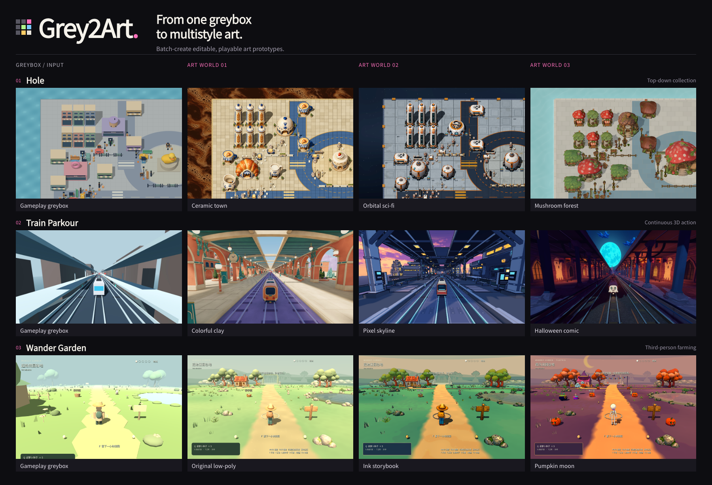
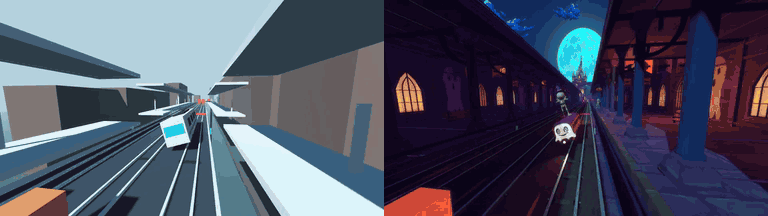
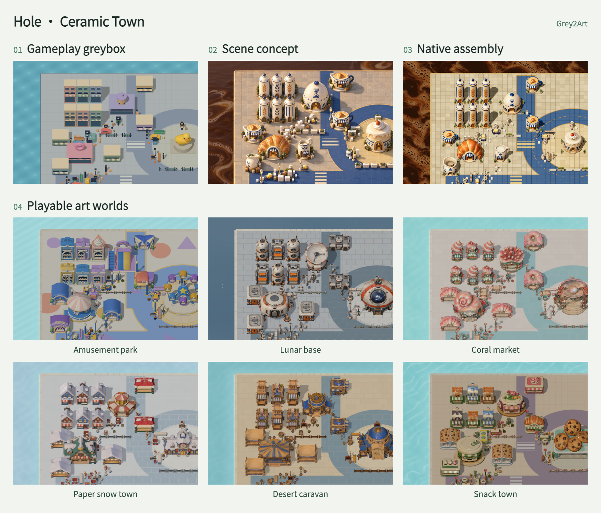
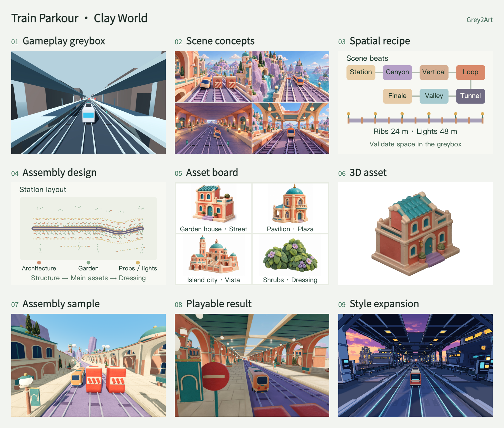
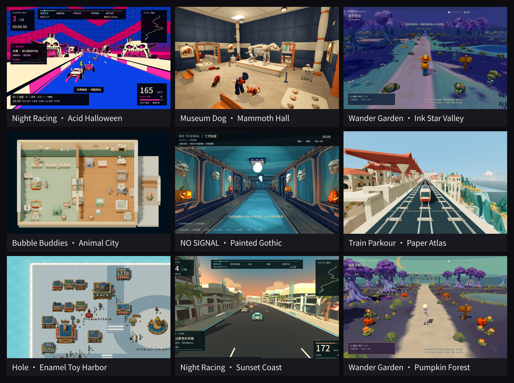

# Grey2Art

[English](README.md) · [简体中文](README.zh-CN.md)

**Turn one gameplay greybox into playable prototypes in multiple art styles.**

[Setup](#requirements) · [Install](#quickstart) · [Capabilities](#capabilities) · [Workflow](#workflow) · [Showcases](#showcases) · [Docs](#docs-and-tools) · [Community](#community)

Grey2Art is an Agent Skill for Codex, Claude Code and WorkBuddy. Turn an existing playable greybox into one or more art versions, or start with a gameplay brief or reference and build the greybox first. Outputs remain editable in Godot or Unity.

For users: follow setup and task examples below. For agents: start with [SKILL.md](skills/greybox-to-multistyle-art/SKILL.md).

<p align="center"></p>

## Capabilities

Use the same gameplay to compare art directions, develop a vertical slice, or extend an existing style to new areas. Start with a priority style's complete playable sample, then carry the remaining selected styles through production.

| Task | What the agent does |
|---|---|
| Explore styles | Develop scene concepts and compare composition, materials and atmosphere. |
| Plan the scene | Work out key views, spatial layout, asset responsibilities and assembly order. |
| Produce and assemble | Combine generated models, reusable assets and native geometry in an editable scene. |
| Revise and continue | Make local changes, check affected gameplay and resume interrupted work. |

Design reviews and production plans keep the work directed: choose references, agree on costs, then produce assets. Asset inspection, remeshing routes and native scene checks support the work as needed. [Capabilities and tools](docs/CAPABILITIES.md)

## Gameplay

<p align="center"><a href="docs/demo/train-halloween-preview.mp4"></a></p>

[Greybox video](docs/demo/train-greybox-preview.mp4) · [Art video](docs/demo/train-halloween-preview.mp4) · [Hole gameplay GIF](docs/demo/hole-ceramic-motion.gif)

## Requirements

| Prepare | Choose |
|---|---|
| Agent and Python | Codex, Claude Code or WorkBuddy with local command execution; [Python 3.10+](https://www.python.org/downloads/). |
| Authoring and validation | [Blender](https://www.blender.org/download/) for spatial greyboxes, scale, cameras and geometry; [Godot](https://godotengine.org/download/) / [Unity](https://unity.com/download) for playable loops, interactions and runtime tests. Choose for the task and retain existing project versions. |
| Image tools | Use your host's image tool or configure an [image service](skills/greybox-to-multistyle-art/references/image-services.md) for concepts and modeling references. |
| AI 3D provider | Choose one when generating new models: Lux3D, Meshy, Tripo, Rodin or Hi3D. [Sign up and configure](docs/INSTALL.md#choose-an-ai-3d-provider) |

Blender is a DCC tool; a spatial greybox or `.blend` delivery needs no game engine. Greybox work needs no image or 3D account. Prepare Pillow for image operations, and review costs before paid generation.

## Quickstart

Download and extract the [complete Skill package](https://github.com/hbzheng0942/grey2art/releases/download/v0.15.0/greybox-to-multistyle-art-0.15.0.zip). Inside the extracted `greybox-to-multistyle-art/` directory, run:

```sh
python3 scripts/install.py --host auto --replace
```

From a source checkout, use `python3 skills/greybox-to-multistyle-art/scripts/install.py --host auto --replace` at the repository root.

On Windows use `py -3`. Refresh skills or start a new session, then choose a starting request.

**Existing greybox, one style**

```text
Use greybox-to-multistyle-art to turn <project path> into a clay-style playable art prototype.
Preserve gameplay, target <engine and device>, and keep the project editable.
```

**One greybox, multiple styles**

```text
Use greybox-to-multistyle-art to make paper, pixel and clay playable versions of <project path>.
Preserve gameplay. Complete a whole paper-style sample first, then the other two styles.
Target: <device>.
```

**Build a greybox first**

```text
Use greybox-to-multistyle-art to create a top-down collection game in Godot at <new directory>.
First build and check a playable greybox with movement, collection and level completion,
then develop it into a toy-style art prototype.
```

You can start with spatial validation:

```text
Use greybox-to-multistyle-art to block out <scene> in Blender.
Check scale, layout and camera views, deliver an editable .blend,
then integrate it into <Godot/Unity> for a playable sample.
```

**Start from a game reference**

```text
Use greybox-to-multistyle-art to explore <core gameplay> from <game link, screenshots or recording>.
Describe controls, camera and rules, and list what is unclear. Build one small greybox level
in <engine> at <directory>, check its core loop, then make a <style> playable art prototype.
Target: <device>.
```

Replace paths, styles and devices with your own, or ask the agent to propose art directions. References establish the core experience; hidden rules and dimensions need separate clarification. The agent checks the project and setup first, then presents references and costs before new asset production.

[Installation and setup](docs/INSTALL.md) · [Complete first task](skills/greybox-to-multistyle-art/references/quickstart-en.md) · [User manual (中文)](https://lq9n5lvfn2i.feishu.cn/docx/GkWEdSrpnoNnioxHNqbcCLmZnVc)

## Workflow

**Greybox → art direction → scene and asset design → playable sample → multistyle expansion.**

The level determines the intermediate work. A compact scene can move quickly from a concept to assembly; a longer route benefits from several key views, a rough spatial model and an explicit assembly plan. Review these decisions before committing to detailed assets.

### Hole

Ceramic Town follows the greybox's layout from concept to native assembly. The final panel shows six other playable art directions built around the same gameplay.

<p align="center"><a href="docs/demo/grey2art-workflow-hole.en.png"></a></p>

### Train Parkour

Colorful Clay turns scene concepts into a spatial recipe for route rhythm, massing and camera constraints, then an asset and assembly plan. Rough geometry checks massing and camera views before asset boards, 3D assets, an assembled slice and the playable result. Other styles extend the same gameplay.

<p align="center"><a href="docs/demo/grey2art-workflow-train.en.png"></a></p>

Deliverables include editable scenes and resources, references and assembly plans, gameplay captures, and the records needed to continue the work.

## Showcases

<p align="center"><a href="docs/demo/grey2art-gallery.png"></a></p>

## Docs and tools

[Documentation](docs/README.md) · [Asset tools](docs/CAPABILITIES.md#functional-tool-entry-points) · [Support](docs/SUPPORT.md) · [Contribute](CONTRIBUTING.md) · [Release notes](CHANGELOG.md) · [MIT](LICENSE) · [Third-party notices](THIRD_PARTY_NOTICES.md)

## Community

[Discord](https://discord.gg/BKAVwyEMQh) · [WeChat](docs/COMMUNITY.md#wechat-seed-user-group)


