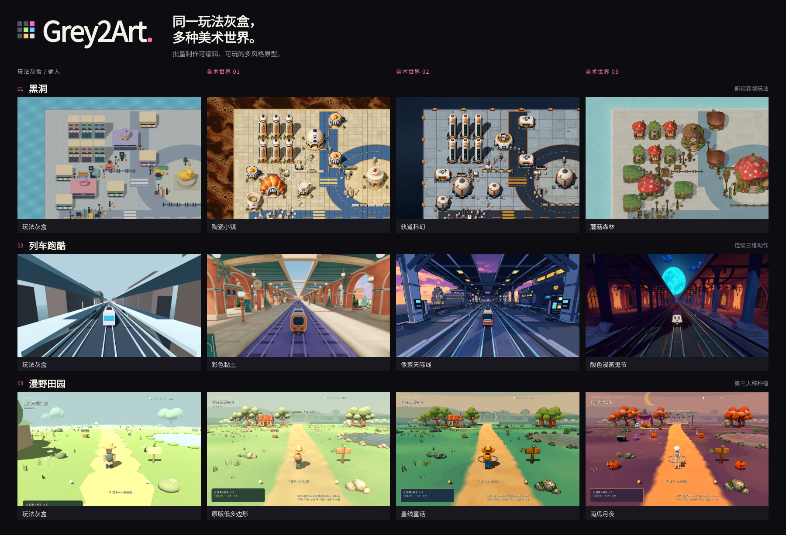
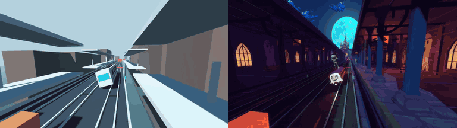
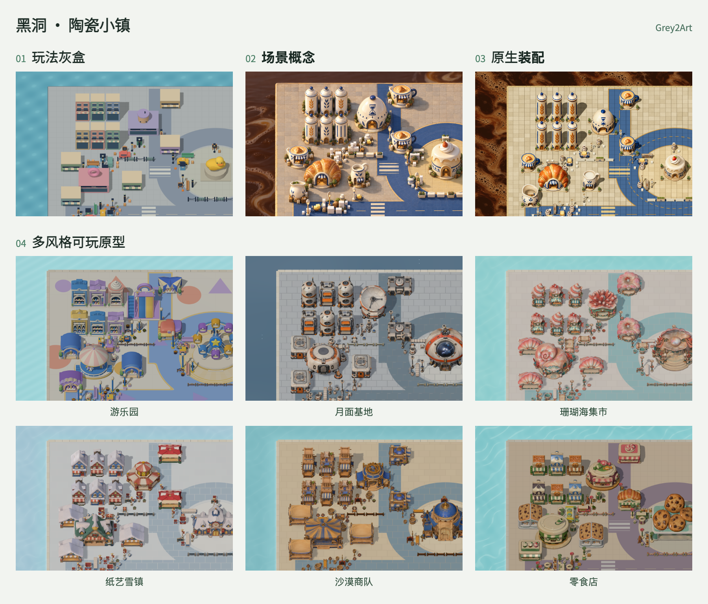
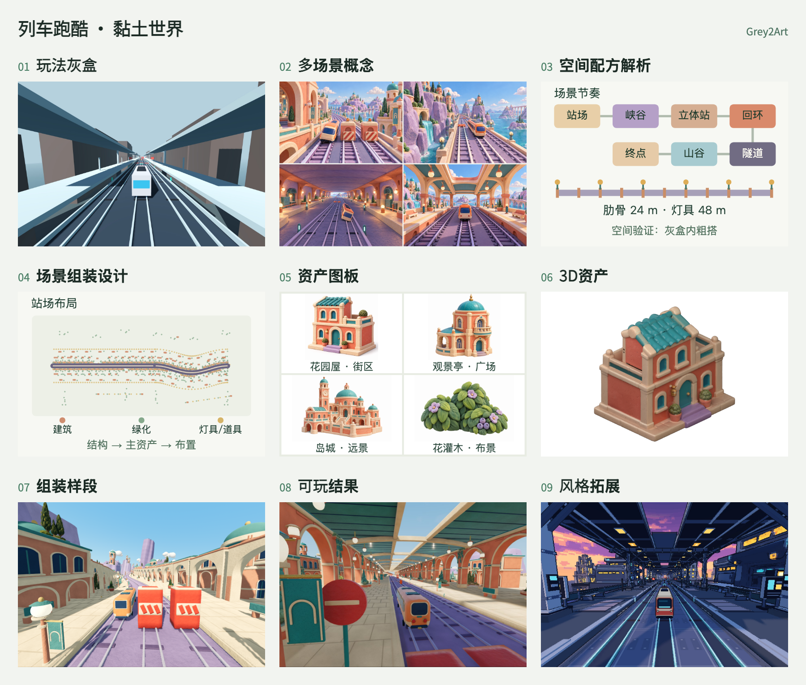
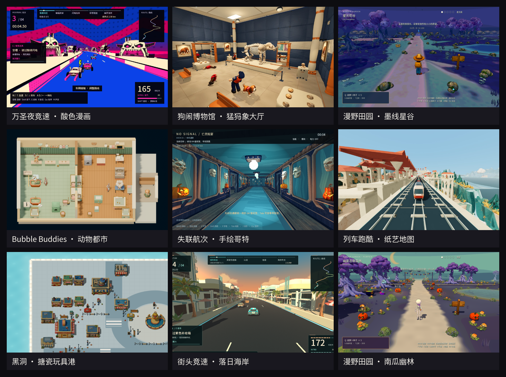

# Grey2Art

[English](README.md) · [简体中文](README.zh-CN.md)

**从同一玩法灰盒，批量制作多种美术风格的可玩原型。**

[配置](#所需条件) · [安装](#快速开始) · [功能](#核心能力) · [工作流](#工作流) · [案例](#案例展示) · [文档](#文档与工具) · [社区](#社区)

Grey2Art 是面向 Codex、Claude Code 和 WorkBuddy 的 Agent Skill。从已有可玩灰盒出发，制作单个或多个美术版本；也可以从玩法需求、游戏参考开始，先搭建灰盒，再推进美术。产物保留为可编辑的 Godot／Unity 工程。

使用者从配置与示例开始；agent 从 [SKILL.md](skills/greybox-to-multistyle-art/SKILL.md) 读取执行方法。

<p align="center"></p>

## 核心能力

适合围绕同一玩法比较美术方向、制作完整样段，或把已有风格延伸到新区域。先贯通优先风格的可玩样段，再完成其余选中风格的生产与装配。

| 任务 | Agent 做什么 |
|---|---|
| 探索风格 | 生成场景概念，比较构图、材质与氛围。 |
| 规划场景 | 确定关键视角、空间布局、资产分工与装配顺序。 |
| 制作与装配 | 结合生成模型、已有资产与引擎原生结构，制作可编辑场景。 |
| 修改与接续 | 局部调整、检查受影响的玩法，接续中断的任务。 |

先评审设计、确定参考与费用，再进入资产生产；按需使用资产体检、减面路线和原生场景检查。[功能与工具](docs/CAPABILITIES.zh-CN.md)

## 实际玩法

<p align="center"><a href="docs/demo/train-halloween-preview.mp4"></a></p>

[灰盒视频](docs/demo/train-greybox-preview.mp4) · [美术视频](docs/demo/train-halloween-preview.mp4) · [Hole 玩法动图](docs/demo/hole-ceramic-motion.gif)

## 所需条件

| 准备什么 | 如何选择 |
|---|---|
| Agent 与 Python | Codex、Claude Code 或 WorkBuddy，可执行本地命令；[Python 3.10+](https://www.python.org/downloads/)。 |
| 制作与验证工具 | [Blender](https://www.blender.org/download/) 用于空间灰盒、尺度、镜头和几何验证；[Godot](https://godotengine.org/download/)／[Unity](https://unity.com/download) 用于可玩循环、交互与运行测试。按任务选择，已有工程沿用原版本。 |
| 生图工具 | 复用宿主生图工具，或配置[图像服务](skills/greybox-to-multistyle-art/references/image-services.md)，用于概念与建模参考。 |
| AI 3D 供应商 | 新生成模型时选择一家：Lux3D、Meshy、Tripo、Rodin 或 Hi3D。[注册与配置](docs/INSTALL.zh-CN.md#选择-ai-3d-供应商) |

Blender 是 DCC 工具；只交付空间灰盒或 `.blend` 时无需游戏引擎。灰盒阶段无需生图或 3D 账户，Pillow 按图像操作需要准备；付费生成前先确认设计与费用。

## 快速开始

下载并解压[完整 Skill 安装包](https://github.com/hbzheng0942/grey2art/releases/download/v0.15.0/greybox-to-multistyle-art-0.15.0.zip)，在解压后的 `greybox-to-multistyle-art/` 目录执行：

```sh
python3 scripts/install.py --host auto --replace
```

如果使用源码仓库，在仓库根目录执行 `python3 skills/greybox-to-multistyle-art/scripts/install.py --host auto --replace`。

Windows 使用 `py -3`。刷新 Skill 或开启新会话，选择一种起点向 agent 提出任务。

**已有灰盒，单个风格**

```text
使用 greybox-to-multistyle-art，把 <工程路径> 做成黏土风可玩美术原型。
保留现有玩法，目标 <引擎和设备>，保持工程可编辑。
```

**同一灰盒，多个风格**

```text
使用 greybox-to-multistyle-art，把 <工程路径> 做成纸艺、像素、黏土三种可玩原型。
保留玩法；先贯通纸艺风完整样段，再完成其余两种，目标 <设备>。
```

**从零搭灰盒，再做美术**

```text
使用 greybox-to-multistyle-art，在 <新目录> 用 Godot 做一个俯视收集游戏。
先实现移动、收集和完成关卡的可玩灰盒，检查通过后制作成玩具风美术原型。
```

也可先做空间验证：

```text
使用 greybox-to-multistyle-art，先用 Blender 搭建 <场景> 的空间灰盒，
检查尺度、布局和镜头，交付可编辑 .blend；再接入 <Godot/Unity> 制作可玩样段。
```

**从游戏参考开始**

```text
使用 greybox-to-multistyle-art，参考 <游戏链接、截图或录屏> 的 <核心玩法>。
先梳理操作、镜头和规则，列出尚不明确的部分；在 <目录> 用 <引擎> 做一个小关卡灰盒，
验证核心循环后，再制作 <风格> 可玩美术原型，目标 <设备>。
```

把路径、风格和设备替换成你的目标；也可以让 agent 先提美术方向。参考案例用于确定核心体验，隐藏规则与尺寸需要另行确认。Agent 会先检查工程和配置，生产新资产前展示参考与费用。

[安装与配置](docs/INSTALL.zh-CN.md) · [完整首次任务](skills/greybox-to-multistyle-art/references/quickstart-zh.md) · [用户手册](https://lq9n5lvfn2i.feishu.cn/docx/GkWEdSrpnoNnioxHNqbcCLmZnVc)

## 工作流

**玩法灰盒 → 美术方向 → 场景与资产设计 → 可玩样段 → 多风格扩展。**

中间环节取决于场景：紧凑关卡可以较快从概念进入装配，较长路线则需要关键视角套图、空间粗模与明确的组装计划。先评审这些决定，再投入精细资产。

### 黑洞

陶瓷小镇沿用灰盒布局，从场景概念推进到原生装配。末格展示围绕同一玩法完成的另外六种美术方向。

<p align="center"><a href="docs/demo/grey2art-workflow-hole.zh-CN.png"></a></p>

### 列车跑酷

彩色黏土从场景套图提炼空间 recipe，明确路线节奏、体块和镜头约束，再整理资产分工与组装关系。先用粗几何验证体量与镜头，再整理资产图板、制作 3D 资产，推进到组装样段和可玩结果，最后围绕同一玩法扩展风格。

<p align="center"><a href="docs/demo/grey2art-workflow-train.zh-CN.png"></a></p>

交付包含可编辑场景与资源、参考和组装方案、玩法录制，以及后续接续任务所需的信息。

## 案例展示

<p align="center"><a href="docs/demo/grey2art-gallery.zh-CN.png"></a></p>

## 文档与工具

[文档导航](docs/README.md) · [资产工具](docs/CAPABILITIES.zh-CN.md#功能工具入口) · [问题反馈](docs/SUPPORT.md) · [参与贡献](CONTRIBUTING.zh-CN.md) · [发行说明](CHANGELOG.md) · [MIT](LICENSE) · [第三方声明](THIRD_PARTY_NOTICES.md)

## 社区

[Discord](https://discord.gg/BKAVwyEMQh) · [微信群](docs/COMMUNITY.zh-CN.md#微信种子用户群)


