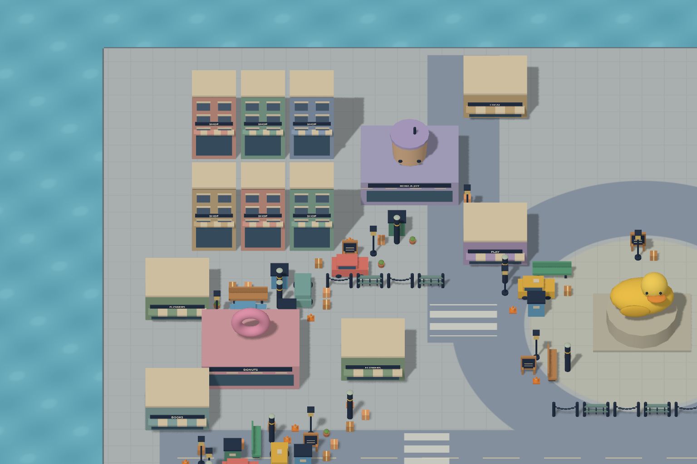
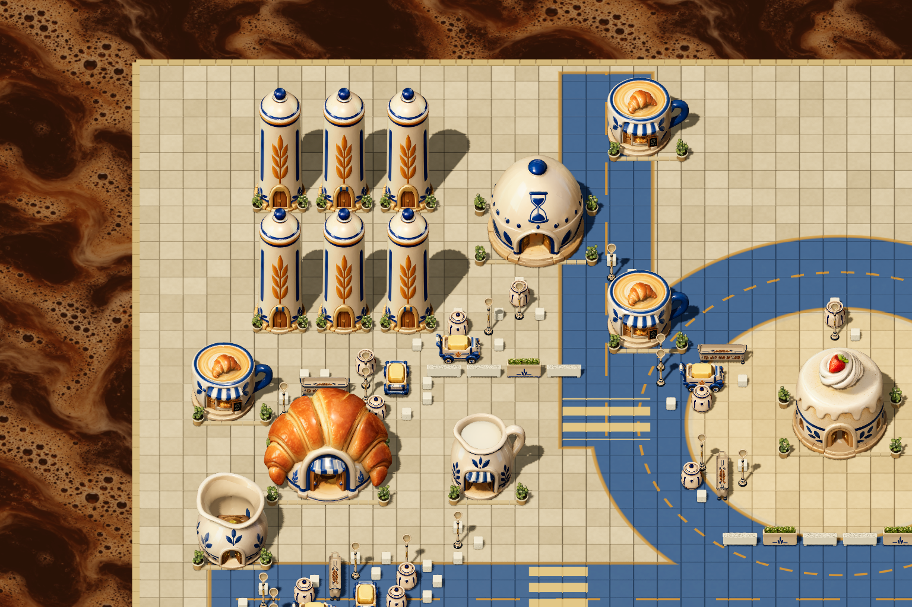
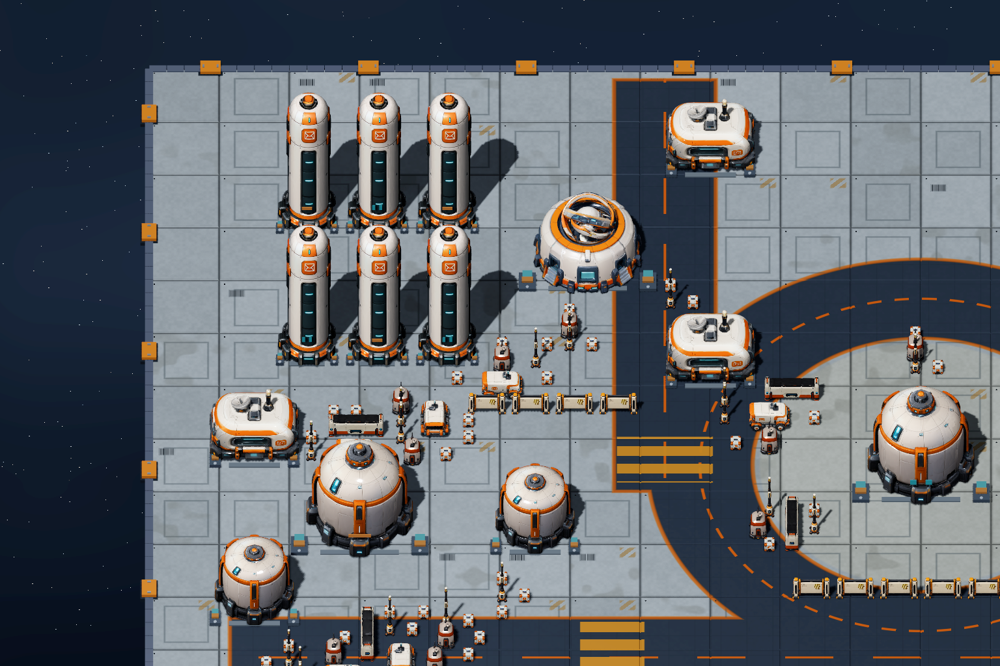
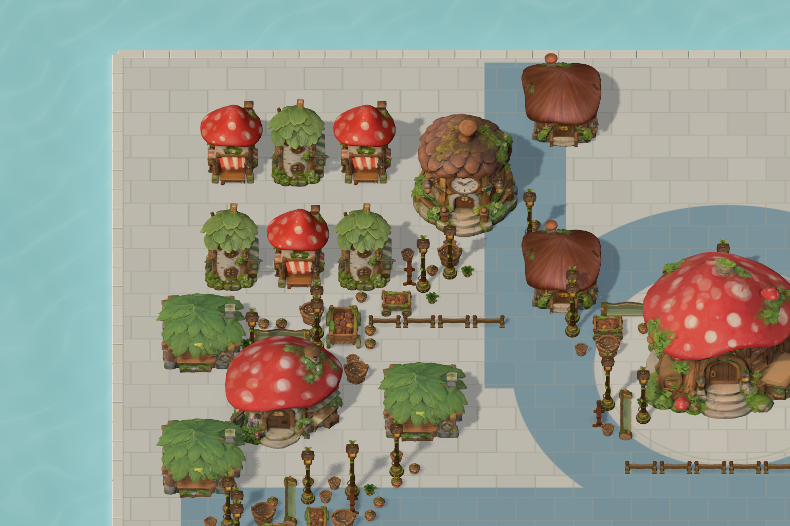
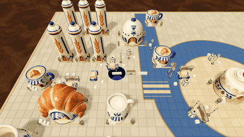

# Hole / 黑洞

[All showcases / 全部案例](README.md) · [Editable source / 可编辑工程](https://github.com/hbzheng0942/greybox-to-multistyle-art-showcases/blob/ab75441b078713b14842a284ddebfe306ab03aa3/games/hole/GAME.md)

The selected ceramic and orbital images are historical native frames. The greybox and mushroom forest were newly captured with their recorded orthographic camera: position `[-12,16,6]`, target `[-12,0,-8]`, `KEEP_HEIGHT`, size `19`, at 1536×1024. Each full frame keeps the source scene’s objects and asset bounds. [Camera and image identities](../demo/hole-reference-camera.json).

陶瓷小镇和轨道科幻采用选定的历史原生截图；灰盒与蘑菇森林按其记录中的同一正交相机补拍：位置 `[-12,16,6]`、目标 `[-12,0,-8]`、`KEEP_HEIGHT`、size `19`、1536×1024。四格均完整显示原帧，保留来源场景的对象与资产边界。[相机与截图记录](../demo/hole-reference-camera.json)。

| Greybox / 灰盒 | Ceramic town / 陶瓷小镇 | Orbital sci-fi / 轨道科幻 | Mushroom forest / 蘑菇森林 |
|:---:|:---:|:---:|:---:|
|  |  |  |  |

Ceramic Hole, seven seconds of continuous native automatic-route action. / 陶瓷 Hole，七秒连续原生自动路线片段。[GIF source / 动图来源](../demo/grey2art-motion-sources.json).

Credit: Grey2Art showcase contributors; projects published by [hbzheng0942](https://github.com/hbzheng0942/greybox-to-multistyle-art-showcases). Input version `original-v0.3-input`; ceramic/orbital `hole-lookdev-validated / case-final-v2 / baseline`; mushroom forest `five-worlds-mycelium-001`. Source game and media rights retain their own scope.

署名与版本沿用来源记录：输入为 `original-v0.3-input`，陶瓷／科幻为历史 lookdev baseline，蘑菇为 `five-worlds-mycelium-001`。游戏与媒体保留各自权利。

The [recording index](https://github.com/hbzheng0942/greybox-to-multistyle-art-showcases/blob/0986dc2cfec6a7b21e0e257c83ec1b62fd960ebb/media/README.md) describes existing ceramic/orbital gameplay footage and resource download instructions. A matching greybox/three-selected-style video set remains pending. This selection combines two historical images and two new still captures; it does not establish current Skill end-to-end production, human art/gameplay acceptance or real-time performance.

来源录制索引提供既有陶瓷／科幻玩法实录与资源取得方式；完整匹配的灰盒与三风格视频仍待补齐。本组选图由两张历史原帧和两张新补拍组成，不替代当前 Skill 的端到端生产、美术／玩法人工接受或实时性能验证。
