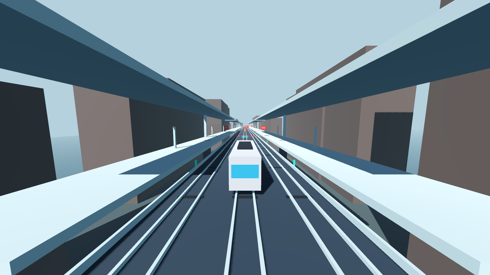
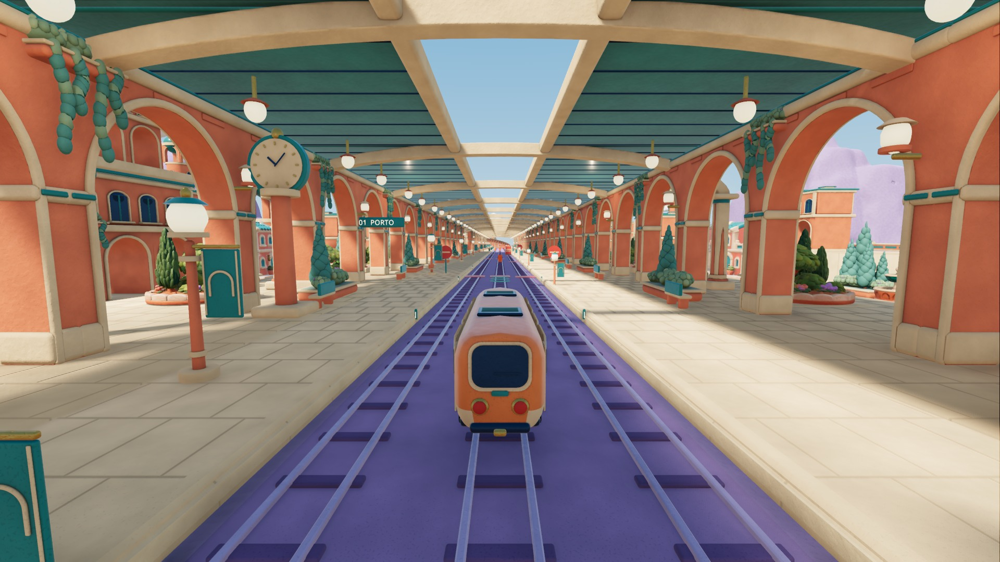
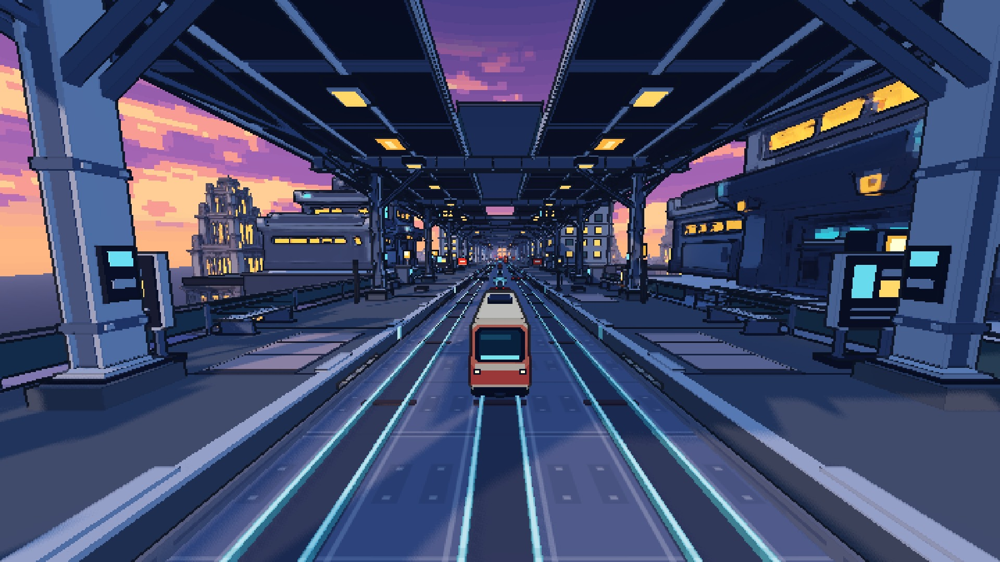
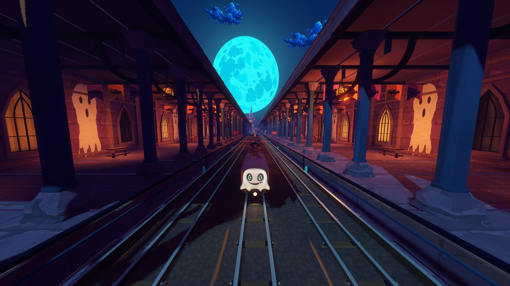
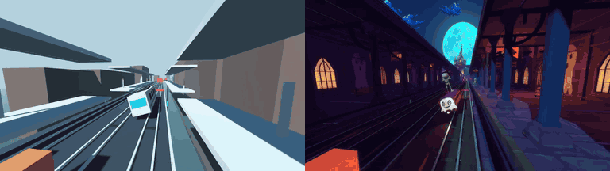

# Train Parkour / 列车跑酷

[All showcases / 全部案例](README.md) · [Source project / 工程](https://github.com/hbzheng0942/greybox-to-multistyle-art-showcases/blob/0986dc2cfec6a7b21e0e257c83ec1b62fd960ebb/games/train-parkour/GAME.md)

One train-action baseline with three distinct station worlds. Corresponding forward station views show warm clay, a pixel skyline and a Halloween night while retaining the shared movement and route baseline. Native screenshots hide prototype HUD and debug overlays.

同一列车动作玩法，变成暖色黏土、像素天际线和鬼节夜景三种站区世界。选图使用对应的站区前视，保留共用运动与路线基线；原生截图隐藏了原型 HUD 和调试叠层。

| Greybox / 灰盒 | Colorful clay / 彩色黏土 | Pixel skyline / 像素天际线 | Halloween comic / 酸色漫画鬼节 |
|:---:|:---:|:---:|:---:|
|  |  |  |  |

Greybox left → H07 right. Eight seconds of existing offline native action; approximate matching. / 左灰盒、右 H07：既有离线原生连续动作，近似匹配。

[Watch larger greybox / 观看大图灰盒片段](../demo/train-greybox-preview.mp4) · [Watch larger Halloween / 观看大图鬼节片段](../demo/train-halloween-preview.mp4) · [GIF sources / 动图来源](../demo/grey2art-motion-sources.json)

These short, silent previews are transcodes of existing offline native recordings. [Source and encoding record](../demo/grey2art-video-sources.json). / 两段静音短片由既有离线原生录制转码，来源和编码方式见记录。

Credit: Grey2Art showcase contributors; projects published by [hbzheng0942](https://github.com/hbzheng0942/greybox-to-multistyle-art-showcases). Source project and media rights retain their own scope.

署名：Grey2Art 案例贡献者；工程由 hbzheng0942 发布。游戏与媒体资源保留来源项目各自权利。

## Versions and recordings / 版本与录制

- Input: `m1.7r2-unified-v2`; clay: `P21`; pixel: `route-finish / continuous + bold`; Halloween: `city08 + T2 + Festival V2 + staged train readability`.
- The [recording index](https://github.com/hbzheng0942/greybox-to-multistyle-art-showcases/blob/0986dc2cfec6a7b21e0e257c83ec1b62fd960ebb/media/README.md) lists existing greybox, Halloween and Odd Logistics clips. Video bytes are part of the complete resources, not source-only Git. They use fixed-input offline native rendering at 1920×1080, encoded at 30 fps, with no audio. Their matching is approximate; encoded frame rate does not establish real-time performance.
- The selected clay/pixel/Halloween video set is not yet complete. Still frames do not prove synchronized gameplay input. Engine launch, route checks, visual acceptance, human play and target-device frame rate remain separate results; these frames do not qualify the current Skill release.

灰盒为 `m1.7r2-unified-v2`，黏土为 P21，像素为 V2 全线收尾，鬼节为 city08／T2／Festival V2／列车可读性修正的组合。已有灰盒、鬼节与怪诞物流视频，按录制索引和完整资源流程取得；它们是无声的 1080p 原生离线录制，编码 30 fps，仅近似匹配，不能据此宣称实时 30 FPS。所选三个美术方向的完整对照视频仍待补齐。
