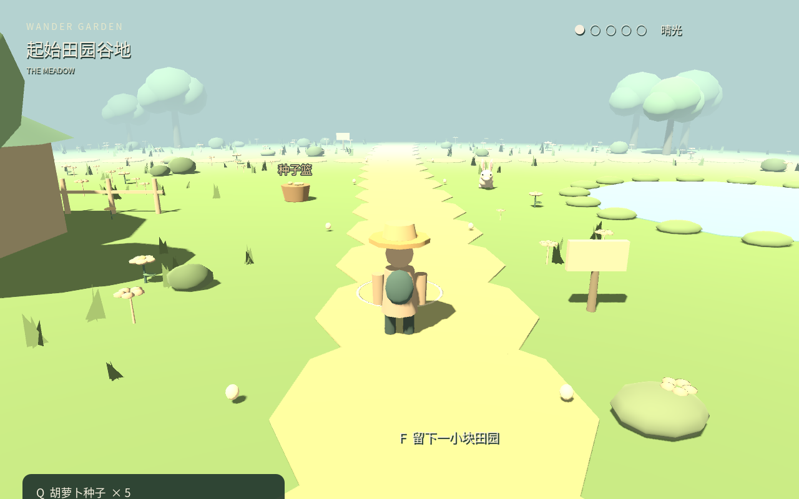
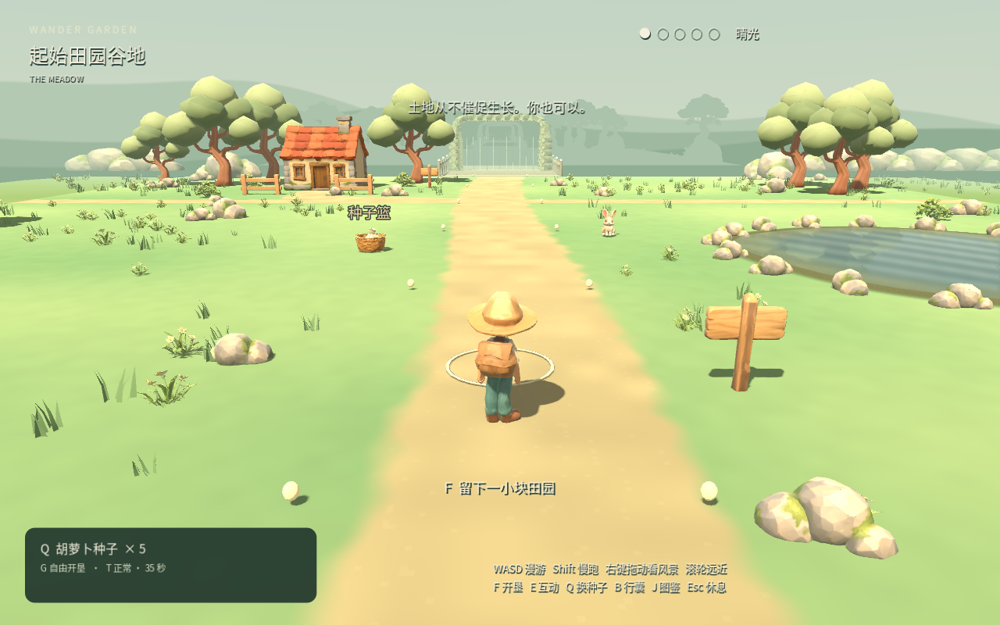
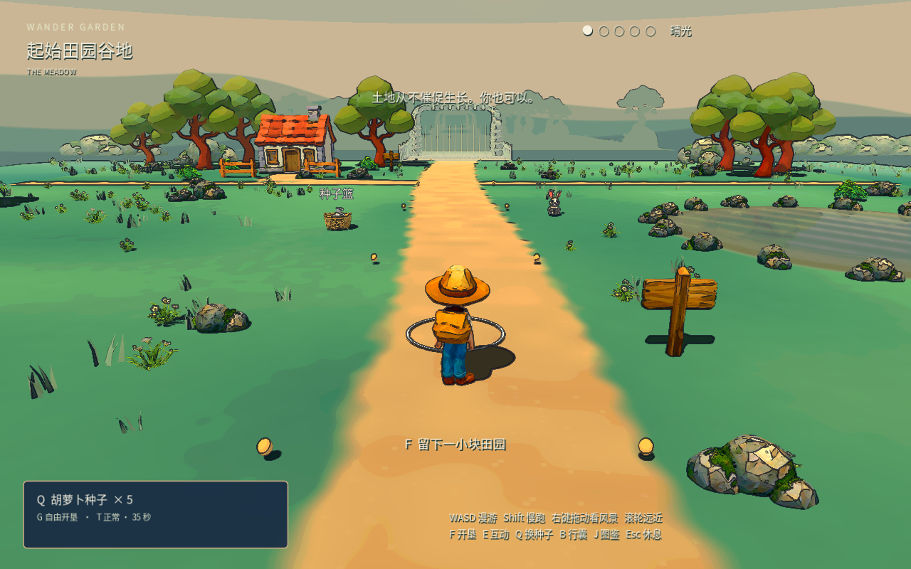
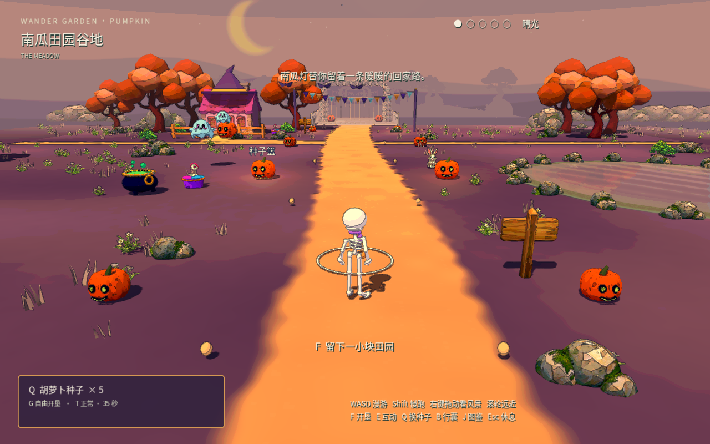

# Wander Garden / 漫野田园

[All showcases / 全部案例](README.md) · [Project and downloads / 工程与下载](https://github.com/xuanyuc1999-ops/wander-garden-demos)

A third-person farming game with an actual v0.2 gameplay greybox and three existing art versions: original low-poly, ink storybook and pumpkin moon. The greybox preserves its colored procedural models. The original remains a separate art version, not a third newly produced style.

第三人称种植玩法，现已展示真实 v0.2 玩法灰盒，以及原版低多边形、墨线童话和南瓜月夜三个既有美术版本。灰盒保留自身的程序化彩色模型；原版仍是独立美术版本，不计为第三个新制作风格。

| Input / 输入 | Original low-poly / 原版低多边形 | Ink storybook / 墨线童话 | Pumpkin moon / 南瓜月夜 |
|:---:|:---:|:---:|:---:|
|  |  |  |  |

Author: [xuanyuc1999-ops](https://github.com/xuanyuc1999-ops). The three art frames are pinned to source commit [`78ac8dadab0bdf82f1af97d967dea3a847d4da9a`](https://github.com/xuanyuc1999-ops/wander-garden-demos/tree/78ac8dadab0bdf82f1af97d967dea3a847d4da9a). The greybox was captured from the user-supplied `WanderGarden-v0.2-source.zip`; its archive SHA-256 is `fc32528fd1d53f01f697ea110aca37a622e57b7cb5fc794932e4e31ed03c8480`. The archive is not published here. Game, assets and media retain their source rights.

作者为 xuanyuc1999-ops。三张美术图绑定上述固定提交；灰盒来自用户提供的 `WanderGarden-v0.2-source.zip`，压缩包哈希如上，原压缩包不随本仓库发布。游戏、资产和媒体保留来源项目各自权利。

## Source and viewpoint / 源码与机位

Eleven base files (`main.tscn`, nine `scripts/*.gd` files and `tests/capture.gd`) match the public original base by Git blob, including planting, pets and gate logic. The public original v0.9.1 runs `play_meadow.tscn` with its art runtime layer, so the greybox and original art cells are distinct versions of the same gameplay source.

11 份基础文件（`main.tscn`、9 份 `scripts/*.gd`、`tests/capture.gd`）与公开原版 base 逐项 Git blob 相同，包含种植、宠物及开门逻辑。公开原版 v0.9.1 通过 `play_meadow.tscn` 和美术运行层启动，因此灰盒与原版美术是同玩法来源的不同版本。

The new 1280×800 native frame follows the meadow reference capture recipe. The earlier art frames lack complete actual camera receipts, and art production rearranged the cabin and vegetation. These are preserved version differences; strict pixel alignment is not claimed. [Source, camera and image receipt](../demo/garden-greybox-source.json) · [Media provenance](../demo/PROVENANCE.md).

新截图为 1280×800 原生画面，采用对应谷地参考机位。旧美术图缺少完整实际相机收据，小屋与植被也在美术制作中重排；保留这些真实版本差异，不声称严格逐像素对齐。来源、相机与图片身份见上述记录。

## Play and scope / 运行与范围

The repository provides editable Godot 4.7.2 projects and Windows/Web packages. Follow its download guide; Web packages require local serving and are not an immediately hosted browser-play URL. These links are independent of Skill installation.

来源仓库提供可编辑 Godot 4.7.2 工程及 Windows／Web 包，按其下载指南运行。Web 包需要本地静态服务，不将下载链接写成已托管的浏览器试玩链接；案例与 Skill 安装无关。

The screenshots preserve the source game's UI. The new greybox check passed native startup and still capture in Godot 4.7.2 / OpenGL Compatibility; it does not establish five-region completion, performance, human acceptance or a new greybox-to-three-style production result. Clean gameplay clips remain a media follow-up.

截图保留来源游戏自身 UI。新灰盒在 Godot 4.7.2 / OpenGL Compatibility 中通过原生启动与静帧采集；未验证五区通关、性能、人工接受或本轮「灰盒到三个新风格」生产结果。干净玩法实录仍待补充。
